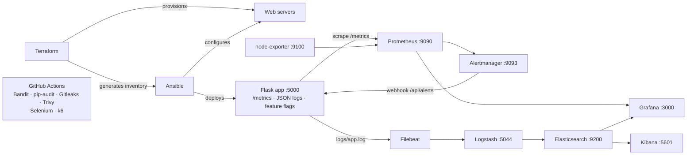

# Lab 3: Monitoring, Logging & DevSecOps

| | |
|---|---|
| **Student Name** | Amit |
| **Roll No.** | 2301010471 |
| **Lab** | Lab 3: Monitoring, Logging & DevSecOps |
| **Tools** | Terraform, Ansible, Prometheus, Grafana, Alertmanager, Elasticsearch, Logstash, Kibana, Filebeat, GitHub Actions, Bandit, pip-audit, Gitleaks, Trivy, k6, Selenium |

---

## 1. Objective

Design an **automated, observable and secure** infrastructure workflow:

1. **Automate** infrastructure provisioning (Terraform) and configuration (Ansible).
2. **Monitor** the application and host with Prometheus + Grafana (with alerting).
3. **Centralise logs** with the ELK stack (Filebeat → Logstash → Elasticsearch → Kibana).
4. **Integrate security & quality** into the DevOps process: pipeline security scanning, feature flags, load testing and automated browser testing.

---

## 2. Architecture



---

## 3. Repository Structure

```
.
├── app/                              # Demo application (Flask)
│   ├── app.py                        # metrics, JSON logging, REST API, alert webhook
│   ├── feature_flags.py              # feature-flag engine
│   ├── config/flags.json             # feature flag definitions
│   ├── templates/  static/           # web UI
│   └── requirements.txt
├── terraform/                        # Infrastructure provisioning
├── ansible/                          # Configuration management playbooks
├── monitoring/
│   ├── prometheus/                   # prometheus.yml, alert_rules.yml
│   ├── alertmanager/                 # alertmanager.yml
│   └── grafana/                      # datasources + dashboard
├── logging/
│   ├── filebeat/filebeat.yml
│   └── logstash/                     # pipeline + config
├── selenium/test_ui.py               # automated browser tests
├── load-testing/k6-load-test.js      # load tests
└── .github/workflows/devsecops.yml   # DevSecOps pipeline
```

---

## 4. Running the Application

```bash
python -m venv .venv
# Windows: .venv\Scripts\activate     Linux: source .venv/bin/activate
pip install -r app/requirements.txt
python app/app.py
```

Open http://localhost:5000. Logs are written to `logs/app.log`.

| Service | URL |
|---|---|
| App | http://localhost:5000 |
| Prometheus | http://localhost:9090 |
| Alertmanager | http://localhost:9093 |
| Grafana | http://localhost:3000 (admin / admin) |
| Elasticsearch | http://localhost:9200 |
| Kibana | http://localhost:5601 |

---

## 5. Experiments

### Experiment 1: Infrastructure Provisioning with Terraform

`terraform/` provisions a network and `web_server_count` (default 2) nginx web servers with health checks and labels. It also **generates the Ansible inventory** (`ansible/inventory/terraform_web.ini`) from the resources it created. Input variables are validated.

```bash
cd terraform
cp terraform.tfvars.example terraform.tfvars   # on Windows set docker_host = "npipe:////./pipe/docker_engine"
terraform init
terraform validate
terraform plan
terraform apply
terraform output
terraform apply -var web_server_count=3        # scale out
terraform destroy                              # clean up
```

---

### Experiment 2: Configuration Management with Ansible

| Playbook | Purpose |
|---|---|
| `playbooks/setup_host.yml` | installs packages, sets `vm.max_map_count` for Elasticsearch, creates the Python venv, renders `flags.json`, installs and starts the app as a **systemd** service |
| `playbooks/configure_web.yml` | hardens the Terraform web servers (`server_tokens off`), adds `/health.json`, reloads nginx |
| `playbooks/verify.yml` | health-checks the app, Prometheus, Alertmanager, Grafana, Elasticsearch and Kibana |
| `playbooks/toggle_flag.yml` | changes a feature flag through configuration management |

```bash
cd ansible                              # Linux / WSL2
ansible-galaxy collection install -r requirements.yml
ansible-playbook site.yml --syntax-check
ansible-playbook site.yml -K
ansible-playbook site.yml -K            # second run shows changed=0 (idempotent)
```

---

### Experiment 3: Monitoring with Prometheus & Alertmanager

Start Prometheus, Alertmanager and node-exporter with the configs in this repo:

```bash
prometheus --config.file=monitoring/prometheus/prometheus.yml
alertmanager --config.file=monitoring/alertmanager/alertmanager.yml
node_exporter
```

**App metrics (`/metrics`):**

| Metric | Type | Meaning |
|---|---|---|
| `app_http_requests_total{method,endpoint,status}` | Counter | request count |
| `app_http_request_duration_seconds` | Histogram | latency (p50/p95/p99) |
| `app_http_requests_in_progress` | Gauge | in-flight requests |
| `app_items_total` | Gauge | stored items |
| `app_feature_flag_enabled{flag}` | Gauge | feature flag state |
| `app_alerts_received_total` | Counter | alerts received from Alertmanager |

**Alert rules (`monitoring/prometheus/alert_rules.yml`):**

| Alert | Condition | Severity |
|---|---|---|
| AppDown | app not scraped for 1m | critical |
| HighErrorRate | 5xx ratio > 5% for 1m | critical |
| HighLatencyP95 | p95 latency > 1s for 1m | warning |
| MaintenanceModeEnabled | kill-switch flag ON | info |
| HostHighCpu | CPU > 80% for 5m | warning |
| HostLowMemory | memory available < 10% for 5m | warning |

Alertmanager sends alerts to the app's `/api/alerts` webhook. The app logs each alert, so alerts also appear in Kibana.

**Example PromQL:**
```promql
sum(rate(app_http_requests_total[1m])) by (endpoint)
histogram_quantile(0.95, sum(rate(app_http_request_duration_seconds_bucket[2m])) by (le))
sum(rate(app_http_requests_total{status=~"5.."}[2m])) / sum(rate(app_http_requests_total[2m]))
```

To trigger alerts, call `http://localhost:5000/api/error` and `http://localhost:5000/api/slow` repeatedly, or stop the app to fire **AppDown**.

---

### Experiment 4: Visualisation with Grafana

Copy the provisioning files into Grafana, then restart it:

```bash
sudo cp monitoring/grafana/provisioning/datasources/datasources.yml /etc/grafana/provisioning/datasources/
sudo cp monitoring/grafana/provisioning/dashboards/dashboards.yml   /etc/grafana/provisioning/dashboards/
sudo mkdir -p /var/lib/grafana/dashboards
sudo cp monitoring/grafana/dashboards/lab3-app-dashboard.json /var/lib/grafana/dashboards/
sudo systemctl restart grafana-server
```

The dashboard **"Lab 3 - Application & Infrastructure Overview"** shows: App Up, requests/sec, error rate, p95 latency, request rate by endpoint, latency percentiles, 4xx/5xx responses, feature flag state, host CPU and memory, and application logs from Elasticsearch.

---

### Experiment 5: Centralised Logging with ELK

**Pipeline:** `app → logs/app.log (JSON) → Filebeat → Logstash → Elasticsearch → Kibana`

```bash
logstash -f logging/logstash/pipeline/logstash.conf
export LAB3_LOG_DIR="$(pwd)/logs"
filebeat -e -c logging/filebeat/filebeat.yml
```

The app writes one JSON object per request:
```json
{"@timestamp":"2026-11-06T10:15:02Z","level":"ERROR","message":"request completed","service":"lab3-app",
 "method":"GET","path":"/api/error","status":500,"duration_ms":1.2,"request_id":"9f1c..."}
```

Logstash parses the JSON and adds the tags `server_error`, `client_error`, `slow_request`, `alert` and `security`. It writes to the daily index `lab3-app-logs-YYYY.MM.DD`.

**In Kibana:** go to Stack Management → Data Views → create `lab3-app-logs-*` with time field `@timestamp`, then open Discover.

| KQL | Finds |
|---|---|
| `tags : "server_error"` | HTTP 5xx |
| `tags : "slow_request"` | requests > 1s |
| `app.event : "prometheus_alert"` | alerts from Alertmanager |
| `tags : "security"` | failed admin-token attempts |

---

### Experiment 6: DevSecOps Pipeline Security Scanning

`.github/workflows/devsecops.yml` runs on every push and pull request.

| Stage | Tool | Purpose |
|---|---|---|
| SAST | Bandit | insecure Python code |
| Dependency scan | pip-audit | packages with known CVEs |
| Secret scan | Gitleaks | leaked passwords and keys in git history |
| FS / IaC scan | Trivy | vulnerabilities, secrets, misconfigurations (HIGH/CRITICAL) |
| IaC validation | terraform fmt / validate | Terraform correctness |
| Config validation | ansible-playbook --syntax-check | playbook correctness |
| Browser tests | Selenium | UI flows |
| Load test | k6 | performance thresholds |

If any security scan fails, the pipeline stops before the tests run.

**Security in the app:** security headers (CSP, X-Frame-Options, nosniff), input validation, XSS-safe rendering, and an admin token (compared in constant time) protecting the flag-toggle API. No secrets are committed.

---

### Experiment 7: Feature Flags

| Flag | Default | Demonstrates |
|---|---|---|
| `new_ui_banner` | ON | release toggle |
| `discount_banner` | ON, 50% | **percentage (canary) rollout**, with users bucketed consistently by SHA-256 |
| `maintenance_mode` | OFF | **kill switch**: writes return HTTP 503 |

**Ways to toggle a flag:**
```bash
# 1. Edit app/config/flags.json; the app reloads it without a restart
# 2. Environment variable when the app starts
FF_NEW_UI_BANNER=false python app/app.py
# 3. Runtime API (start the app with ADMIN_TOKEN=<token>)
curl -X POST localhost:5000/api/flags/maintenance_mode -H "X-Admin-Token: <token>" \
     -H "Content-Type: application/json" -d '{"enabled": true}'
# 4. Ansible
ansible-playbook ansible/playbooks/toggle_flag.yml -e flag=maintenance_mode -e enabled=true
```

Check the current state at `GET /api/flags`. Flag state is also exported to Prometheus and shown in Grafana.

---

### Experiment 8: Load Testing with k6

| Profile | Virtual users | Duration |
|---|---|---|
| `smoke` | 5 | 30s |
| `load` (default) | 20 → 50 | 2.5 min |
| `stress` | 50 → 200 | 3 min |

Thresholds: error rate < 1%, p95 < 500 ms, checks > 99%.

```bash
k6 run -e PROFILE=smoke  load-testing/k6-load-test.js
k6 run                   load-testing/k6-load-test.js
k6 run -e PROFILE=stress load-testing/k6-load-test.js
```

Watch the Grafana dashboard during the test to see the request rate and latency change.

---

### Experiment 9: Automated Browser Testing with Selenium

| Test | Verifies |
|---|---|
| `test_homepage_loads` | page title and health status |
| `test_add_item` | form submit adds an item to the list |
| `test_empty_item_shows_validation_error` | validation message |
| `test_feature_flag_banner_matches_flag_state` | UI banners match the feature flag state |

```bash
pip install -r selenium/requirements.txt
pytest selenium/test_ui.py -v
HEADLESS=0 pytest selenium/test_ui.py -v    # watch the browser
```

---

## 6. Observations

| # | Experiment | Observation |
|---|---|---|
| 1 | Terraform | `plan` previews changes. Changing `web_server_count` adds or removes only the difference, and the inventory is generated automatically. |
| 2 | Ansible | The second run shows `changed=0` (idempotent). One command configures the host and deploys the app. |
| 3 | Prometheus | All targets UP. Repeated `/api/error` calls fire HighErrorRate, and stopping the app fires AppDown. |
| 4 | Grafana | The dashboard updates live, and error and latency spikes are clearly visible. |
| 5 | ELK | Logs reach Kibana within seconds, and structured JSON makes filtering easy. |
| 6 | DevSecOps | The pipeline blocks commits with vulnerabilities or leaked secrets. |
| 7 | Feature flags | Behaviour changes without a redeploy. The 50% rollout splits users consistently, and the kill switch blocks writes instantly. |
| 8 | k6 | p95 stays under 500 ms at normal load and rises under stress, showing where capacity runs out. |
| 9 | Selenium | All UI tests pass in headless Chrome, both locally and in CI. |

---

## 7. Conclusion

Terraform and Ansible turn infrastructure and configuration into repeatable code. Prometheus, Grafana and Alertmanager make the system observable and raise alerts on failures. The ELK stack centralises structured logs. Bandit, pip-audit, Gitleaks and Trivy stop insecure code in the pipeline. Feature flags allow safe releases, k6 checks performance, and Selenium confirms the user experience end to end.

---

**Submitted by:** Amit · **Roll No.:** 2301010471
